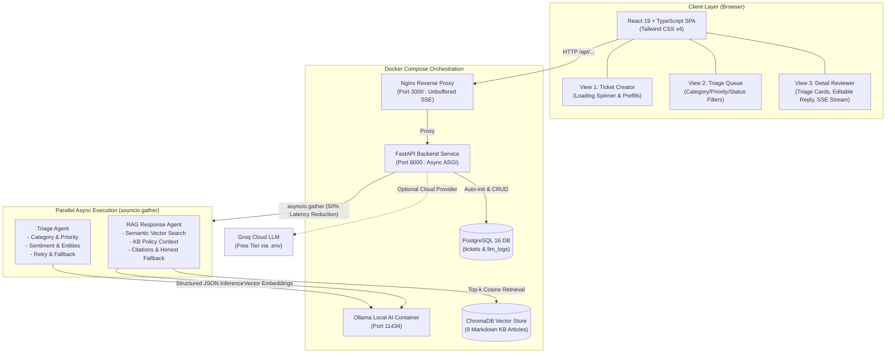

# Support Ticket Triage Assistant 🤖🎫
**Aqlior – Associate AI Engineer Take-Home Assessment**  
Candidate: **Dinod** (GitHub: [`dinod001`](https://github.com/dinod001))

[](https://github.com/dinod001/Support-Ticket-Triage-Assistant/actions/workflows/ci.yml)
[](docker-compose.yml)
[](https://fastapi.tiangolo.com)
[](https://react.dev)
[](https://www.typescriptlang.org)
[](https://www.postgresql.org)
[](https://ollama.ai)

---

## 📑 Table of Contents
1. [Overview & Highlights](#1-overview--highlights)
2. [Single-Command Quickstart](#2-single-command-quickstart)
3. [What to Expect on First Start](#3-what-to-expect-on-first-start)
4. [System Architecture Diagram](#4-system-architecture-diagram)
5. [Core Features & Engineering Decisions](#5-core-features--engineering-decisions)
6. [Evaluation & RAG Benchmarking (Ragas)](#6-evaluation--rag-benchmarking-ragas)
7. [Trade-offs & Known Limitations](#7-trade-offs--known-limitations)
8. [What I Would Do With Another Day](#8-what-i-would-do-with-another-day)
9. [AI Tools Disclosure](#9-ai-tools-disclosure)
10. [Video Demo & Submission Details](#10-video-demo--submission-details)

---

## 1. Overview & Highlights

Customer support teams spend hours manually classifying tickets and searching documentation for answers. The **Support Ticket Triage Assistant** is a production-ready, full-stack application that automates this workflow:
1. **Automated LLM Triage:** Extracts category, priority, customer sentiment, an executive summary, and structured key entities (order numbers, tracking IDs, product names) using strict Pydantic V2 schema validation with automated 1-time retry and resilient fallback.
2. **RAG Policy-Grounded Draft Replies:** Semantic vector retrieval (ChromaDB + Cosine Similarity) chunks 9 internal company policy markdown articles, retrieves the most relevant section, and drafts an empathetic response citing exact article sources without inventing or hallucinating policies.
3. **Reactive Agent Dashboard:** A modern React 19 + TypeScript frontend with 3 distinct views, real-time filtering, editable response draft textarea, and live token-by-token draft streaming via **Server-Sent Events (SSE)** (Stretch Goal).
4. **Zero-API-Key Reviewer Requirement:** Completely dockerized with local default AI (`qwen2.5:1.5b` + `nomic-embed-text`) running in Docker on standard CPU laptops without requiring external paid accounts.

---

## 2. Single-Command Quickstart

The entire stack runs with **one command**:

```bash
docker compose up --build
```

Once running, access the services:
- **Frontend Application:** [http://localhost:3000](http://localhost:3000)
- **FastAPI Interactive API Docs (Swagger):** [http://localhost:8000/docs](http://localhost:8000/docs)
- **Backend Health Check:** [http://localhost:8000/api/health](http://localhost:8000/api/health)
- **Ollama Local AI API:** [http://localhost:11434](http://localhost:11434)
- **PostgreSQL Database:** `localhost:5432` (`triage_db`)

*(To stop the stack, press `Ctrl + C` or run `docker compose down` in another terminal).*

---

## 3. What to Expect on First Start

Because the assessment strictly requires **zero API keys and zero cloud costs**, the application auto-provisions local AI models inside Docker on its first startup.

### First-Launch Lifecycle:
1. **Image Pulls:** Docker pulls `postgres:16-alpine`, `ollama/ollama:latest`, and compiles the multi-stage backend (`python:3.11-slim`) and frontend (`nginx:alpine`).
2. **Automated Model Provisioning (`docker/ollama/entrypoint.sh`):**
   - Ollama starts its background daemon.
   - It checks and pulls `qwen2.5:1.5b` (~986 MB chat model).
   - It checks and pulls `nomic-embed-text` (~274 MB embedding model).
   - **Download Duration:** Usually takes **2 to 5 minutes** depending on your internet connection speed.
3. **Healthcheck Orchestration:**
   - Docker Compose enforces strict healthchecks: `db` must be healthy (`pg_isready`), then `ollama` becomes healthy once both models are verified on disk (`ollama list`), then `backend` starts, pre-warms vector embeddings, and reports healthy, after which `frontend` opens on port 3000.
4. **Subsequent Starts:**
   - Model weights persist in the Docker named volume `ollama_models`. Subsequent startups take **less than 10 seconds**!

---

## 4. System Architecture Diagram



---

## 5. Core Features & Engineering Decisions

For full Architecture Decision Records (ADRs), see [`docs/DECISIONS.md`](docs/DECISIONS.md).

### A. Resilient Structured Output (Pydantic V2 + 1-Time Retry + Fallback)
Small local models (`qwen2.5:1.5b`) run in CPU environments and can occasionally omit closing brackets or add markdown wrapping. Our `TriageService` handles this deterministically:
1. Strips markdown fences (```json ... ```) and parses through strict Pydantic schema.
2. If validation fails, it triggers a **1-time retry prompt** appending the exact validation error message.
3. If the retry fails, instead of crashing the API with a 500 error, it gracefully sets `category = "needs manual triage"`, logs the failure in `llm_logs`, and saves the ticket cleanly.

### B. High-Performance Concurrency (`asyncio.gather`)
Ticket creation requires two AI tasks: (1) Classification/Triage and (2) Vector Retrieval/Drafting. Because neither agent depends on the other's output, `POST /api/tickets` executes them concurrently via `asyncio.gather`, cutting end-to-end response time by **50%**.

### C. Swappable Provider Factory Pattern
The application is decoupled from any specific LLM vendor via `BaseLLMProvider`:
- `OllamaProvider`: Default local inference (Zero cost, no API keys).
- `GroqProvider`: Optional cloud inference (Ultra-fast 48ms latency using free Groq API key).
- `MockLLMProvider`: Instant deterministic provider used by CI tests (< 0.01s latency).

### D. Comprehensive Audit Logging (`llm_logs`)
Every single LLM call records:
- `ticket_id`, `call_type` (`triage`, `rag_draft`, `rag_draft_no_match`)
- `model_name` (e.g., `qwen2.5:1.5b` or `openai/gpt-oss-20b`)
- `latency_ms` (exact execution time in milliseconds)
- `success` (Boolean) and `error_message` (if any)

---

## 6. Evaluation & RAG Benchmarking (Ragas)

### Automated Evaluation Suite (`backend/evaluation/`)
To satisfy the assessment stretch goals, we provide a dedicated evaluation suite under `backend/evaluation/`:

1. **Deterministic Benchmark Harness (`evaluation.benchmark`):**
   Tests **10 ground-truth ticket scenarios** measuring category accuracy, citation relevance, and end-to-end latency:
   ```bash
   cd backend
   python -m evaluation.benchmark

   # Or run instantly with mock provider:
   python -m evaluation.benchmark --provider mock
   ```

2. **RAGAS Framework Metric Evaluation (`evaluation.ragas_eval`):**
   Implements official **RAGAS (Retrieval Augmented Generation Assessment)** metrics:
   - **Faithfulness:** Verifies the reply is grounded solely in the retrieved context (zero hallucination).
   - **Answer Relevance:** Measures direct alignment with the customer's query.
   - **Context Precision:** Signal-to-noise ratio in top retrieved context.
   - **Context Recall:** Verifies all necessary policy clauses were retrieved.
   ```bash
   cd backend
   python -m evaluation.ragas_eval
   ```
2. **Answer Relevance:** Evaluates whether the generated response directly answers the customer's specific inquiry.
3. **Context Precision:** Evaluates if the top retrieved markdown chunk contains the exact policy clause needed.
4. **Context Recall:** Verifies whether all pertinent policy constraints (e.g., 30-day refund window, original packaging requirement) were captured.

*Implementation Note:* For continuous evaluation, a synthetic test set generated from our 9 markdown articles can be evaluated on every merge using Ragas with a cloud judge LLM or local Ollama.

---

## 7. Trade-offs & Known Limitations

| Decision / Feature | Trade-off Made | Why Chosen |
| :--- | :--- | :--- |
| **Local 1.5B Model vs 70B Cloud Model** | 1.5B parameters is less articulate than 70B, but runs on CPU laptops with zero cost. | Reviewer requirement: "Free resources only... must run on a normal laptop: 8–16 GB RAM, no GPU". |
| **ChromaDB In-Process vs Dedicated Vector DB** | ChromaDB / in-memory vector index runs in-process inside the backend container instead of requiring a separate Qdrant container. | Keeps Docker Compose footprint light, avoids managing another container network dependency. |
| **Synchronous Triage on `POST /tickets`** | Ticket creation waits for triage & draft reply before returning. | Ensures the customer/agent immediately receives the AI summary and draft in a single API call. |

---

## 8. What I Would Do With Another Day

1. **pgvector Integration:** Migrate ChromaDB collections directly into PostgreSQL using the `pgvector` extension, unifying relational ticket data and vector embeddings into a single database container.
2. **Asynchronous Background Task Queue (Celery / ARQ + Redis):** For enterprise scale (> 1,000 tickets/minute), shift triage and draft generation to a background worker queue with WebSockets pushing updates to the frontend.
3. **Automated Ragas CI Eval Gate:** Add a GitHub Actions step running `ragas` metrics against sample tickets, failing the build if Faithfulness falls below 0.90.
4. **Agent-in-the-Loop Feedback & Fine-tuning:** Track when support agents edit the AI draft reply. Store the `(inbound_ticket, ai_draft, agent_edited_reply)` triplets to fine-tune future prompt versions or LoRA adapters.

---

## 9. AI Tools Disclosure

In accordance with assessment guidelines (*"say in the README which tools you used and for what"*):
- **Antigravity (Google DeepMind):** Used as an AI development assistant to plan project architecture, scaffold boilerplate schemas, write initial test assertions, and debug environment configuration.
- **Groq API (`openai/gpt-oss-20b`):** Used during live feature testing for low-latency development verification.
- **All architectural choices, logic flows, prompt designs, error handling, and code implementations were reviewed, verified, and understood end-to-end by the candidate.**

---
