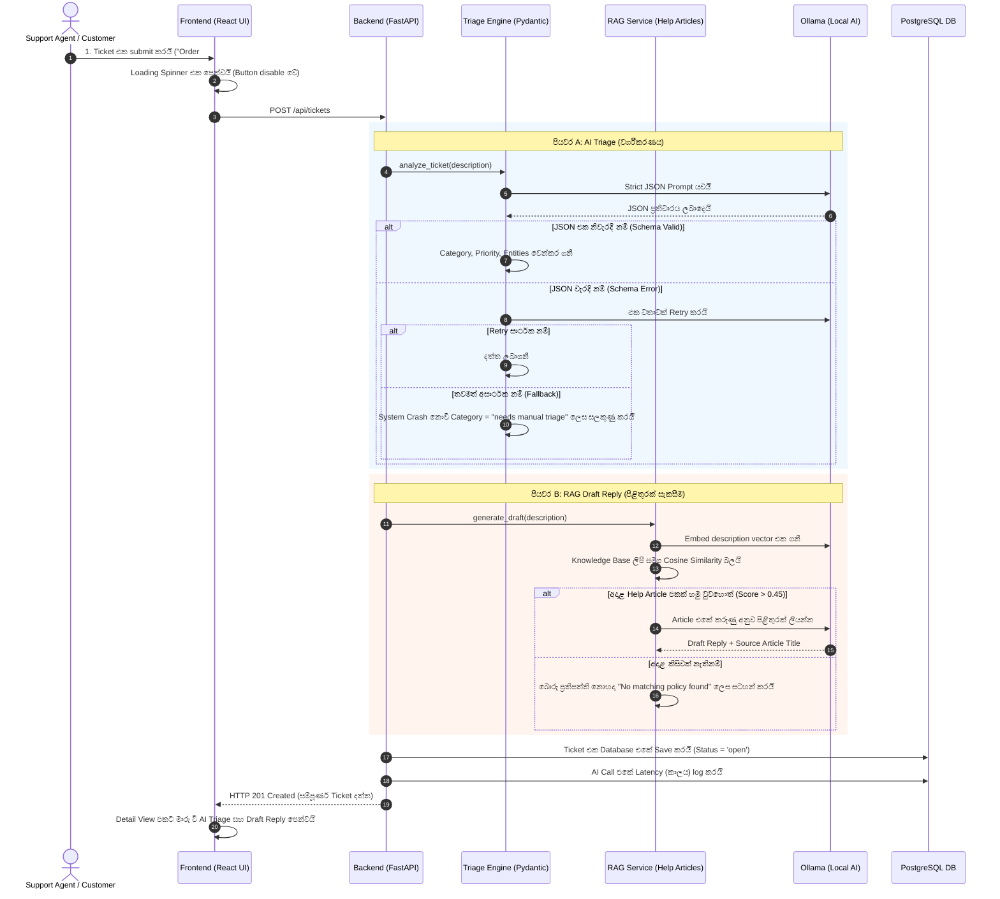
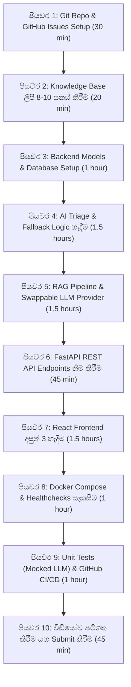

# පද්ධති නිර්මාණ සැලැස්ම සහ ක්‍රියාත්මක කිරීමේ මාර්ගෝපදේශය (System Architecture & Build Guide)

**ව්‍යාපෘතිය (Project):** Support Ticket Triage Assistant  
**තනතුර (Role):** Associate AI Engineer (Aqlior Take-Home Assessment)  
**ඉලක්කය:** කිසිදු මුදලක් වැය නොවන (Zero-Cost), Reviewer ට තනි command එකකින් (`docker compose up --build`) සම්පූර්ණයෙන්ම ක්‍රියාත්මක කළ හැකි Full-Stack AI පද්ධතියක් ගොඩනැගීම.

---

## 1. සමස්ත පද්ධති ව්‍යුහය (Overall System Architecture)

පද්ධතිය එකිනෙකට සම්බන්ධ වූ Docker බහාලුම් (Containers) 4කින් සමන්විත වන අතර, ඒවා අභ්‍යන්තර network එකක් (`triage-network`) හරහා එකිනෙක සන්නිවේදනය කරයි:

```text
+---------------------------------------------------------------------------------------------------+
|                                      Docker අභ්‍යන්තර Network එක                                    |
|                                                                                                   |
|  +--------------------------+       HTTP / REST API        +-----------------------------------+  |
|  |   Frontend (React+Vite)  | ---------------------------> |         Backend (FastAPI)         |  |
|  |       (Port 3000)        |                              |            (Port 8000)            |  |
|  +--------------------------+                              +-----------------------------------+  |
|                                                              |          |                |        |
|                                                 SQLAlchemy   |          |                |        |
|                                                              v          |                |        |
|                                                    +-------------+      |                |        |
|                                                    |  PostgreSQL |      |                |        |
|                                                    | (Port 5432) |      |                |        |
|                                                    +-------------+      |                |        |
|                                                                         |                |        |
|                                                       HTTP JSON API     v                |        |
|                                                              +--------------------+      |        |
|                                                              |   Ollama Local AI  |      |        |
|                                                              |    (Port 11434)    |      |        |
|                                                              | - qwen2.5:1.5b     |      |        |
|                                                              | - nomic-embed-text |      |        |
|                                                              +--------------------+      |        |
|                                                                                          v        |
|                                                                           +--------------------+  |
|                                                                           | Knowledge Base     |  |
|                                                                           | ලිපි 8-10 (Memory)  |  |
|                                                                           +--------------------+  |
+---------------------------------------------------------------------------------------------------+
```

### ප්‍රධාන සංරචක 4 (Core Components):
1. **Frontend (React + Vite + Tailwind CSS):**
   - User Interface එක. මෙහි පිටු/දසුන් 3ක් ඇත:
     - **Form:** Ticket එකක් submit කිරීම.
     - **List:** සියලුම tickets බලාගැනීම සහ Status/Category/Priority අනුව filter කිරීම.
     - **Detail View:** AI එක හොයාගත්ත විස්තර (Triage) සහ හදපු Draft Reply එක බලා Agent ට edit කර save කිරීම.
2. **Backend (Python 3.11 + FastAPI):**
   - REST API එක. Data validation (Pydantic), AI Orchestration, සහ Database transactions මෙහෙයවයි.
3. **Database (PostgreSQL 16):**
   - Tickets වල විස්තර සහ AI latency logs සුරක්ෂිතව තබා ගන්නා Relational Database එක.
4. **Local AI Engine (Ollama):**
   - Docker container එකක් ලෙස run වන Local AI එක. Reviewer ට කිසිම OpenAI/Claude API key එකක් අවශ්‍ය නැත.
   - **Chat/Triage Model:** `qwen2.5:1.5b` (ඉතා සැහැල්ලුයි, CPU එකේ සුමටව run වේ, JSON හරියටම ලබාදේ).
   - **Embedding Model:** `nomic-embed-text` (Help articles සෙවීමට vector සාදයි).

---

## 2. Ticket එකක ජීවන චක්‍රය (Life of a Ticket - Data Flow)

පාරිභෝගිකයෙකු හෝ Support Agent කෙනෙකු Ticket එකක් Submit කළ මොහොතේ සිට අවසානය දක්වා සිදුවන දේ:



---

## 3. මුල සිට අගට Project එක Build කරන පිළිවෙළ (Zero to End Step-by-Step Roadmap)

මෙම පිළිවෙළට අනුව වැඩ කිරීමෙන් පැය 6-8ක් ඇතුළත කිසිදු පැටලීමකින් තොරව ඉතාම ඉහළ ලකුණු ලබාගත හැකි ආකාරයට project එක නිම කළ හැක.



---

### පියවර 1: Git Repo සහ GitHub Issues Setup (විනාඩි 30)
- GitHub එකේ අලුත් Public Repository එකක් සාදන්න.
- Assessment එකේ ඉල්ලන පරිදි GitHub Issues 8-10ක් සාදා `core` සහ `stretch` ලෙස label කරන්න (උදා: *Core 1: Database Setup, Core 2: Triage Engine, Core 3: RAG Pipeline* ආදිය).
- `docs/DECISIONS.md` file එක repo එකට එකතු කරන්න.

### පියවර 2: Knowledge Base Help Articles ලිවීම (විනාඩි 20)
- `backend/app/knowledge_base/` නමින් folder එකක් හදා, Markdown ලිපි 8-10ක් ලියන්න:
  1. `refund_policy.md` (දින 30ක refund කාලය)
  2. `shipping_delivery.md` (දින 3-5 බෙදාහැරීම්)
  3. `password_reset.md` (මුරපදය reset කිරීම)
  4. `account_deletion.md` (ගිණුම් ඉවත් කිරීම)
  5. `order_cancellation.md` (ඇණවුම් අවලංගු කිරීම)
  6. `damaged_items.md` (හානි වූ භාණ්ඩ සඳහා පැය 48ක් ඇතුළත ඡායාරූප)
  7. `subscription_billing.md` (මාසික ගාස්තු සහ plans)
  8. `payment_methods.md` (ගෙවීම් ක්‍රම)

### පියවර 3: Backend Models සහ Database Setup (පැය 1)
- Python 3.11 + FastAPI + SQLAlchemy + Pydantic තෝරාගැනීම.
- **`Ticket` Model:** `id`, `title`, `description`, `customer_email`, `status`, `category`, `priority`, `sentiment`, `summary`, `entities` (JSONB), `draft_reply`, `cited_articles`.
- **`LLMLog` Model:** `id`, `ticket_id`, `call_type`, `model_name`, `latency_ms`, `success`, `error_message`.

### පියවර 4: AI Triage & Fallback Engine එක හැදීම (පැය 1.5)
- Prompts සියල්ල `backend/app/prompts/triage_prompt.py` තුළ තනි තැනක තබන්න.
- Pydantic Schema: `category`, `priority`, `sentiment`, `summary`, `entities`.
- **වඩාත්ම වැදගත් කොටස:** AI එකෙන් ආපු JSON එක validate කරන විට fail වුවහොත්, එක වතාවක් retry කිරීම; තවමත් fail නම් ticket එක crash නොවී `category = "needs manual triage"` ලෙස save වීම.

### පියවර 5: RAG Pipeline & Swappable Provider එක හැදීම (පැය 1.5)
- **Swappable Interface:** `BaseLLMProvider` interface එක සාදා `OllamaProvider` (default) සහ `GroqProvider` / `GeminiProvider` ලිවීම. `.env` එකෙන් මාරු කළ හැකි වීම.
- **RAG Engine:** Help articles 8-10 Backend එක boot වෙද්දී embed කර memory එකේ තබාගෙන, ticket එකක් ආ විට Cosine Similarity බලයි.
- ගැලපෙන article එකක් නැත්නම් බොරු ප්‍රතිපත්ති නොහදා "No matching policy found" ලෙස disclaimer එකක් දැක්වීම.

### පියවර 6: FastAPI REST API Endpoints නිම කිරීම (විනාඩි 45)
- `POST /api/tickets`: Ticket එක submit කිරීම (Triage සහ RAG එකවර සිදුවේ).
- `GET /api/tickets`: Tickets ලැයිස්තුව (Status, Category, Priority filters සමඟ).
- `GET /api/tickets/{id}`: තනි ticket එකක විස්තර.
- `PATCH /api/tickets/{id}`: Agent විසින් draft එක edit කර save කිරීම සහ status update කිරීම.

### පියවර 7: React Frontend දසුන් 3 හැදීම (පැය 1.5)
- React (Vite) + Tailwind CSS භාවිතා කර පිරිසිදු, පැහැදිලි UI එකක් හැදීම:
  - **Screen 1 (Form):** Create Ticket (AI processing සිදුවන විට **Loading Spinner** එක පැහැදිලිව පෙන්වීම).
  - **Screen 2 (Dashboard):** Filter dropdowns (Open, Resolved, Urgent, Technical) සහිත Ticket Card List එක.
  - **Screen 3 (Detail View):** AI Triage Badges (Summary, Priority, Sentiment), Editable Draft Textarea, Cited Articles ලැයිස්තුව, සහ "Save & Resolve" Button.

### පියවර 8: Docker Compose & Healthchecks සැකසීම (පැය 1)
- `docker-compose.yml`:
  - `postgres`: Healthcheck `pg_isready` සහිතව.
  - `ollama`: Script එකක් මගින් `qwen2.5:1.5b` සහ `nomic-embed-text` auto-pull වීම.
  - `backend`: Postgres සහ Ollama healthy වනතුරු රැඳී සිට boot වීම.
  - `frontend`: Backend එකට connect වීම.
- Reviewer හට `docker compose up --build` ගැසූ පමණින් සියල්ල run වීම!

### පියවර 9: Unit Testing (Mocked LLM) & GitHub CI/CD (පැය 1)
- `pytest` මගින් tests 3ක් ලිවීම (Assessment එකේ විශේෂයෙන් ඉල්ලූ tests):
  1. Triage parsing & validation (invalid JSON fallback එකද ඇතුළුව).
  2. Ticket create & list API test.
  3. Sample query එකකට නිවැරදි article එක retrieve වන බවට RAG test.
- **අවවාදයයි:** Tests වලදී සැබෑ LLM call නොකර `unittest.mock` මගින් mock කළ යුතුය! එවිට GitHub CI එකේදී තත්පර 10කින් pass වේ.
- GitHub Actions: PR වලදී tests & linting run වීම, `main` එකට merge වූ විට GHCR වෙත Docker image push වීම.

### පියවර 10: වීඩියෝව පටිගත කිරීම (විනාඩි 10–15) සහ Submit කිරීම
- Google Drive එකට upload කර "Anyone with the link can view" permission දෙන්න.
- වීඩියෝවේ අන්තර්ගතය:
  1. `docker compose up --build` කර ticket එකක් triage වන හැටි පෙන්වීම.
  2. Code structure සහ architecture පැහැදිලි කිරීම.
  3. **Live Code Change:** කැමරාව ඉදිරියේ අලුත් Category එකක් ලෙස **"Billing"** add කර (prompt, schema, frontend filter, unit test) branch එකකින් PR එකක් දමා GitHub Actions CI pass වන හැටි පෙන්වීම.
- ඊමේල් එක යැවීම: `yasitha@aqlior.com` (CC: `shamila@aqlior.com`, `thusidan@aqlior.com`).

---

## 4. සාර්ථක වීමට රහස් උපදෙස් (Pro-Tips for High Marks)

1. **AI Call එක slow වුණත් UI එක හිර නොවී තබාගන්න:** Frontend එකේ "AI is analyzing ticket & drafting reply..." කියා ලස්සන Loading indicator එකක් පෙන්වන්න.
2. **Prompts එක තැනක තබන්න:** `backend/app/prompts/` හි තැබීමෙන් video එකේදී "Billing" category එක add කිරීම තත්පර 30කින් කළ හැක.
3. **No API Keys in Repo:** කිසිදු secret එකක් commit නොකරන්න. `.env.example` පමණක් තබන්න.
4. **Mocked Tests in CI:** CI එකේදී Ollama download කරන්න යන්න එපා; assessment එකේදීම පවසා ඇත්තේ tests mock කළ යුතු බවයි.
