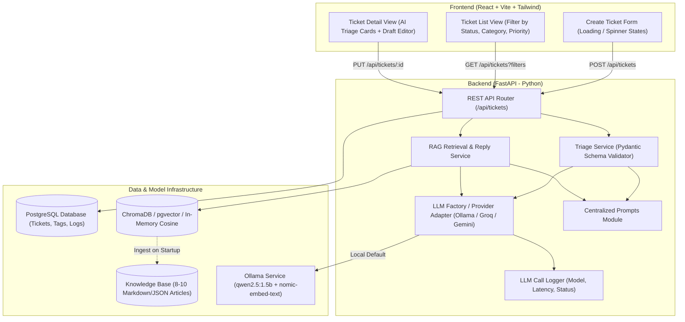
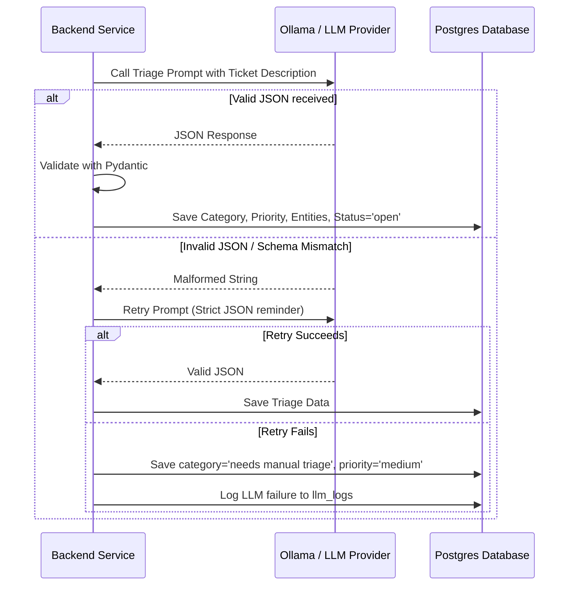

# Support Ticket Triage Assistant
## Take-Home Assessment Guide, System Architecture & End-to-End Implementation Plan

> **Candidate:** Dinod  
> **Role:** Associate AI Engineer at Aqlior  
> **Submission Deadline:** Monday, 16 November 2026, 9:00 AM UAE time (10:30 AM Sri Lanka time)  
> **Estimated Effort:** ~1 working day (approx. 8 hours)  
> **Target Evaluation:** Full-Stack (25%), AI/GenAI (25%), DevOps (20%), Code Quality & Testing (15%), Workflow & Organization (15%)

---

## 1. Executive Summary & Brief Overview (Sinhala & English)

### Brief Overview (සිංහල සාරාංශය)
මෙම Assessment එකේ ප්‍රධාන අරමුණ වන්නේ Customer Support Tickets ස්වයංක්‍රීයව වර්ගීකරණය (Triage) කර පිළිතුරු ረቂක් (Draft Replies) සකස් කර දෙන **Full-stack AI Web Application** එකක් නිර්මාණය කිරීමයි.

**මූලිකවම කළ යුතු දේවල් 4:**
1. **Ticket Submission / Creation:** Support agent කෙනෙකුට හෝ customer කෙනෙකුට ticket එකක් submit කළ හැකි සරල Form එකක්.
2. **AI Triage (Structured Output):** Ticket එකක් ආ විගස AI මගින් එහි Category, Priority, Sentiment, One-line Summary, සහ Entities (Order Numbers, Product Names) Extract කර JSON එකක් ලෙස ලබාගැනීම. Schema validation fail වුවහොත් retry කර, තවදුරටත් fail නම් app එක crash නොවී `"needs manual triage"` ලෙස save වීම.
3. **RAG-based Draft Reply:** Repo එකේ ඇති 8–10 Knowledge Base help articles embed කර, අදාළ articles retrieve කර පිළිතුරක් draft කිරීම සහ source article titles පෙන්වීම. කිසිවක් හමු නොවුණහොත් බොරු ප්‍රතිපත්ති (hallucinations) නොහදා "no relevant article found" ලෙස දැක්වීම.
4. **Agent Review UI:** Support agent හට AI විසින් triage කළ විස්තර සහ draft reply එක බලා, අවශ්‍ය නම් edit කර, status update කර save කිරීමට හැකි වීම.

**Key Technical Constraints:**
- **Zero Cost (Free resources only):** Paid API keys අවශ්‍ය නොවිය යුතුය. Default එක ලෙස local AI model (Ollama inside Docker: `qwen2.5:1.5b` හෝ `llama3.2:3b` සහ `nomic-embed-text`) run විය යුතුය. කැමති නම් Groq/Gemini optional provider එකක් ලෙස `.env` මගින් switch කිරීමට හැක.
- **Single Command Run:** `docker compose up --build` පමණක් run කළ විට reviewer ගේ මැෂිමේ සියල්ල (Frontend, Backend, Postgres, Ollama + Models) up & running විය යුතුය.
- **CI/CD:** GitHub Actions මගින් PR එකකදී tests (mocked LLM), linting, Docker build වීම සහ `main` branch එකට merge වූ විට GHCR වෙත Docker image push වීම.
- **Video Submission (10–15 mins):** Live demo, code walkthrough, සහ camera එක ඉදිරිපිට "Billing" category එක add කර PR එකක් දමා CI pass වෙන ආකාරය පෙන්වීම.

---

## 2. High-Level System Architecture



---

## 3. Recommended Technology Stack

| Component | Technology | Rationale |
| :--- | :--- | :--- |
| **Backend** | Python 3.11 + FastAPI | Clean async REST endpoints, automatic OpenAPI docs, native integration with Pydantic for strict JSON schema validation. |
| **Database** | PostgreSQL 16 + SQLAlchemy / Alembic | Robust relational model, easy docker containerization, migration support. |
| **AI / Embeddings** | Ollama (Local) + `qwen2.5:1.5b` / `nomic-embed-text` | Ultra-fast lightweight CPU inference (1-3GB RAM), fully free, zero API key required. |
| **Optional LLM** | Groq (`llama-3.1-8b-instant`) or Google Gemini | Lightning fast free tier if reviewer specifies an API key in `.env`. |
| **Vector Search / RAG** | In-memory Cosine Sim / ChromaDB / pgvector | For 8-10 documents, numpy cosine similarity or ChromaDB keeps footprint lightweight and setup 100% reliable. |
| **Frontend** | React 18 (Vite) + Tailwind CSS + Lucide Icons | Fast compile, clean UI components, instant responsiveness, clear loading states. |
| **Containerization** | Docker & Docker Compose | Multi-stage builds, internal network, automated healthchecks for deterministic startup. |
| **CI/CD** | GitHub Actions | Automated PR testing (pytest with unittest.mock) and merge CD deployment to GHCR. |

---

## 4. End-to-End Database Schema & Data Models

### Ticket Schema
```sql
CREATE TABLE tickets (
    id SERIAL PRIMARY KEY,
    title VARCHAR(255) NOT NULL,
    description TEXT NOT NULL,
    customer_email VARCHAR(255),
    status VARCHAR(50) DEFAULT 'open',          -- 'open', 'in_progress', 'resolved', 'closed'
    category VARCHAR(50),                       -- 'Technical', 'Refund', 'Shipping', 'Account', 'needs manual triage'
    priority VARCHAR(20),                       -- 'low', 'medium', 'high', 'urgent'
    sentiment VARCHAR(20),                      -- 'positive', 'neutral', 'negative', 'frustrated'
    summary TEXT,
    entities JSONB DEFAULT '{}'::jsonb,         -- {"order_number": "...", "product": "..."}
    ai_triage_raw JSONB,
    draft_reply TEXT,
    cited_articles JSONB DEFAULT '[]'::jsonb,   -- ["Refund Policy", "Shipping Times"]
    agent_notes TEXT,
    created_at TIMESTAMP WITH TIME ZONE DEFAULT NOW(),
    updated_at TIMESTAMP WITH TIME ZONE DEFAULT NOW()
);

CREATE TABLE llm_logs (
    id SERIAL PRIMARY KEY,
    ticket_id INTEGER REFERENCES tickets(id) ON DELETE SET NULL,
    call_type VARCHAR(50),                      -- 'triage', 'rag_draft'
    model_name VARCHAR(100) NOT NULL,
    latency_ms INTEGER NOT NULL,
    success BOOLEAN NOT NULL,
    error_message TEXT,
    created_at TIMESTAMP WITH TIME ZONE DEFAULT NOW()
);
```

---

## 5. Structured Output & RAG Pipeline Design

### 5.1 Triage Schema (Pydantic)
```python
from pydantic import BaseModel, Field
from typing import List, Optional, Dict

class TriageResult(BaseModel):
    category: str = Field(description="Category of the ticket, e.g., Technical, Shipping, Refund, Account")
    priority: str = Field(description="Priority: low, medium, high, urgent")
    sentiment: str = Field(description="Customer sentiment: positive, neutral, negative, frustrated")
    summary: str = Field(description="One sentence summary of the issue")
    entities: Dict[str, Optional[str]] = Field(
        default_factory=dict, 
        description="Extracted key details such as order_number, product_name, email, tracking_id"
    )
```

### 5.2 Resilient Retry & Fallback Mechanism


### 5.3 Knowledge Base Sample Articles (8-10 Topics)
Create Markdown or JSON files under `backend/app/knowledge_base/`:
1. `kb_refund_policy.md` (Refund window 30 days, conditions, turnaround time)
2. `kb_shipping_delivery.md` (Standard 3-5 days, express 1-2 days, tracking numbers)
3. `kb_password_reset.md` (Self-service reset link, 2FA recovery)
4. `kb_account_deletion.md` (GDPR compliance, steps in settings, 14-day grace period)
5. `kb_order_cancellation.md` (Cancellations allowed before dispatch only)
6. `kb_damaged_items.md` (Photo proof required within 48 hours of delivery)
7. `kb_subscription_management.md` (Upgrading, downgrading, pausing billing cycles)
8. `kb_payment_methods.md` (Accepted credit cards, PayPal, bank transfers)

### 5.4 RAG Drafting Policy
- If top cosine similarity score is below threshold (e.g. `< 0.45`), do **not** hallucinate or invent rules.
- Draft: *"Thank you for reaching out. We could not find a relevant policy article in our knowledge base for your inquiry. A human support agent will review your ticket and assist you shortly."*
- If articles match: Cite source article titles prominently (e.g. `[Source: kb_shipping_delivery.md]`).

---

## 6. Project Directory Structure

```text
Support-Ticket-Triage-Assistant/
├── .github/
│   └── workflows/
│       ├── ci.yml                 # Runs linting, pytest (mocked LLM), docker build on PR
│       └── cd.yml                 # Pushes image to GHCR on merge to main
├── doc/
│   ├── Aqlior – Associate AI Engineer Take-Home Assessment.pdf
│   ├── README.md                  # Detailed plan and assessment breakdown
│   └── DECISIONS.md               # Architectural decision record (ADR)
├── backend/
│   ├── app/
│   │   ├── api/
│   │   │   ├── tickets.py         # REST CRUD endpoints & filters
│   │   │   └── health.py          # /api/health endpoint
│   │   ├── core/
│   │   │   ├── config.py          # Pydantic Settings (.env loader)
│   │   │   └── database.py        # SQLAlchemy session & engine
│   │   ├── models/
│   │   │   ├── ticket.py          # SQLAlchemy models
│   │   │   └── log.py
│   │   ├── schemas/
│   │   │   ├── ticket.py          # TicketCreate, TicketResponse schemas
│   │   │   └── triage.py          # TriageResult Pydantic schema
│   │   ├── prompts/
│   │   │   ├── triage_prompt.py   # Isolated prompt templates
│   │   │   └── rag_prompt.py
│   │   ├── services/
│   │   │   ├── llm_factory.py     # Swappable LLM interface (Ollama / Groq / Gemini)
│   │   │   ├── triage_service.py  # Structured triage + retry + fallback
│   │   │   ├── rag_service.py     # Document embedder & retriever
│   │   │   └── logger_service.py  # LLM call latency & status tracker
│   │   ├── knowledge_base/        # 8-10 sample help articles (.md)
│   │   └── main.py                # FastAPI entrypoint
│   ├── tests/
│   │   ├── test_api.py            # Ticket create/list/get API tests
│   │   ├── test_triage.py         # Schema validation & fallback logic
│   │   └── test_rag.py            # Retrieval matching test
│   ├── Dockerfile
│   ├── requirements.txt
│   └── alembic/                   # Database migrations (or init.sql)
├── frontend/
│   ├── src/
│   │   ├── components/
│   │   │   ├── TicketList.jsx     # Filterable list (status, category, priority)
│   │   │   ├── TicketDetail.jsx   # Triage view + editable draft reply
│   │   │   ├── CreateTicket.jsx   # Form with loading/error banners
│   │   │   └── Navbar.jsx
│   │   ├── services/
│   │   │   └── api.js             # Axios / fetch client
│   │   ├── App.jsx
│   │   └── main.jsx
│   ├── Dockerfile
│   ├── package.json
│   ├── tailwind.config.js
│   └── vite.config.js
├── docker-compose.yml             # Orchestrates postgres, ollama, backend, frontend
├── ollama-entrypoint.sh           # Auto-pulls qwen2.5:1.5b & nomic-embed-text on first start
├── .env.example                   # Clean template (no secrets committed)
├── .gitignore
└── README.md                      # Primary project README (for reviewer)
```

---

## 7. Step-by-Step Implementation Roadmap

### Phase 1: Planning, Issue Tracker & Project Setup (~30 mins)
1. **GitHub Issues:** Initialize repo, create 8-10 discrete issues labeled `core` and `stretch`.
   - *Core 1:* Setup Docker Compose with PostgreSQL & Healthchecks.
   - *Core 2:* FastAPI REST API with CRUD & Filtering.
   - *Core 3:* Ollama Local Setup & Automated Model Pulling (`qwen2.5:1.5b`).
   - *Core 4:* Structured Output Triage with Pydantic & Fallback Logic.
   - *Core 5:* Knowledge Base Creation & RAG Retrieval Pipeline.
   - *Core 6:* React Frontend (Create Form, Filtered List, Detail Editor).
   - *Core 7:* Unit & Integration Tests (Mocked LLM).
   - *Core 8:* CI/CD Workflows (GitHub Actions for PR test and GHCR push).
   - *Stretch 1:* Streaming Draft Reply (or Evaluation Script).
2. **Decision Log:** Create `docs/DECISIONS.md` documenting initial stack choices (FastAPI, React, Ollama, Docker Compose).

### Phase 2: Database & Backend Foundation (~2 hours)
1. Create PostgreSQL schema or SQLAlchemy models for `Ticket` and `LLMLog`.
2. Implement REST endpoints in FastAPI:
   - `POST /api/tickets`: Create ticket, trigger triage and RAG draft.
   - `GET /api/tickets`: List tickets with query params (`status`, `category`, `priority`).
   - `GET /api/tickets/{id}`: Detailed ticket view.
   - `PATCH /api/tickets/{id}`: Update status, edited reply, or agent notes.
3. Validate inputs using Pydantic; handle HTTP 400, 404, 500 cleanly with JSON error messages.

### Phase 3: AI Engine, Prompts & RAG (~2 hours)
1. Write 8-10 concise markdown knowledge base articles in `backend/app/knowledge_base/`.
2. Implement `LLMFactory`:
   - Provider interface with `generate_completion` and `get_embedding`.
   - Concrete implementations: `OllamaProvider` (default) and `GroqProvider` / `GeminiProvider`.
3. Implement `TriageService`:
   - System prompt forcing strict JSON conforming to `TriageResult`.
   - Call LLM, measure latency in ms, log into `llm_logs`.
   - If JSON decoding or schema fails, execute single retry with corrective prompt.
   - If retry fails, assign `category="needs manual triage"` and proceed safely.
4. Implement `RAGService`:
   - Compute embeddings for KB articles on startup.
   - For a ticket, compute query embedding, calculate top cosine similarities.
   - Synthesize draft reply referencing cited article titles. Fallback to honest disclaimer if similarity below threshold.

### Phase 4: Frontend Development (~1.5 hours)
1. Build clean, responsive UI with Tailwind CSS:
   - **Ticket List View:** Status badges, priority colors, category tags, search/filter dropdowns.
   - **Create Ticket Form:** Title, description, customer email, with clear loading spinner and error alerts during AI processing.
   - **Ticket Detail View:** AI Triage badge breakdown (Summary, Category, Priority, Sentiment, Extracted Entities), draft response editor, citations list, and Save / Resolve buttons.

### Phase 5: DevOps, Docker & CI/CD (~1.5 hours)
1. Configure `docker-compose.yml`:
   - `db`: PostgreSQL with healthcheck (`pg_isready`).
   - `ollama`: Official Ollama image with initialization script pulling `qwen2.5:1.5b` and `nomic-embed-text`.
   - `backend`: FastAPI app waiting on `db` and `ollama` healthchecks.
   - `frontend`: Vite React app served via Nginx or Node.
2. Setup GitHub Actions:
   - `.github/workflows/ci.yml`: Trigger on PR to `main`. Run `pytest` with mocked LLM (tests pass in seconds without Ollama), verify frontend build, and build docker containers.
   - `.github/workflows/cd.yml`: Trigger on merge to `main`. Build Docker images and push to GHCR tagged with `${{ github.sha }}`.

### Phase 6: Testing & Quality Assurance (~30 mins)
1. **Triage Tests:** Mock Ollama responses; test valid JSON parsing, test invalid JSON triggering retry, and test persistent invalid JSON triggering `"needs manual triage"`.
2. **API Tests:** Test ticket creation, listing with filters, and detail updates using `TestClient`.
3. **Retrieval Tests:** Verify that a sample query about "refund within 14 days" retrieves the refund article.

### Phase 7: Video Demonstration & Submission Prep (~30 mins)
1. Prepare the live walkthrough following the assessment requirements.
2. Practice the live code change: adding the "Billing" category.

---

## 8. Video Recording Script & Checklist (10–15 Minutes)

The assessment explicitly requires a **10–15 minute video** shared via Google Drive link.

### Video Structure
| Timestamp | Segment | Key Talking Points |
| :--- | :--- | :--- |
| **00:00 - 02:30** | **App Startup & Live Demo** | Run `docker compose up --build`. Explain what occurs during the first run (model pulling). Open browser to `http://localhost:3000`. Create a test ticket (e.g., "My order #9921 arrived broken"). Show loading spinner, AI triage result (Category: Damaged/Shipping, Entities: Order #9921), and the RAG-generated draft reply citing the Damaged Items article. Edit the draft and update status to Resolved. |
| **02:30 - 06:30** | **Code Structure Walkthrough** | Show clean repository separation (`backend`, `frontend`, `docker-compose.yml`, `.github/workflows`). Highlight: <br>1. Isolated prompt definitions in `backend/app/prompts/`.<br>2. Swappable LLM provider factory (`Ollama` vs `Groq/Gemini`).<br>3. Pydantic schema validation with retry & fallback to "needs manual triage".<br>4. Unit tests with mocked LLM ensuring fast CI without network calls. |
| **06:30 - 09:30** | **DevOps & Architecture Decisions** | Review `docker-compose.yml` healthcheck ordering, CI/CD pipeline on PR and merge, and highlight decisions recorded in `docs/DECISIONS.md`. |
| **09:30 - 13:30** | **Live Feature Modification on Camera (Crucial)** | **Live task:** Add a new ticket category called **"Billing"**:<br>1. Create branch: `git checkout -b feature/add-billing-category`<br>2. Update Triage Prompt in `backend/app/prompts/triage_prompt.py`.<br>3. Update Allowed Categories in Pydantic schema / DB check.<br>4. Update frontend category filter dropdown in `frontend/src/components/TicketList.jsx`.<br>5. Add a test in `backend/tests/test_triage.py` asserting "Billing" classification.<br>6. Run `pytest` locally to confirm test passes.<br>7. Push branch, open Pull Request on GitHub, and show GitHub Actions CI running and passing green! |
| **13:30 - 15:00** | **Limitations & Future Improvements** | Honestly state limitations (e.g. CPU inference latency, basic in-memory vector index vs scalable pgvector, no multi-tenant auth). Thank the reviewers. |

---

## 9. Submission Checklist

- [ ] Public GitHub repository created.
- [ ] GitHub Issues created and categorized (Core vs Stretch).
- [ ] Feature branches and Pull Requests used throughout development.
- [ ] `docker compose up --build` tested and working cleanly on a fresh clone.
- [ ] `docs/DECISIONS.md` present and filled with rationales.
- [ ] Root `README.md` containing architecture diagram (Mermaid), setup instructions, AI usage disclosure, and limitations.
- [ ] All tests passing with mocked LLM in GitHub Actions CI.
- [ ] CD GitHub Action successfully pushing to GHCR on merge.
- [ ] 10–15 minute video recorded, uploaded to Google Drive, permission set to **"Anyone with the link can view"**.
- [ ] Email sent before **Monday, 16 November 2026, 10:30 AM SL time**:
  - **To:** `yasitha@aqlior.com`
  - **CC:** `shamila@aqlior.com`, `thusidan@aqlior.com`
  - **Content:** GitHub Repository link + Google Drive Video link.
